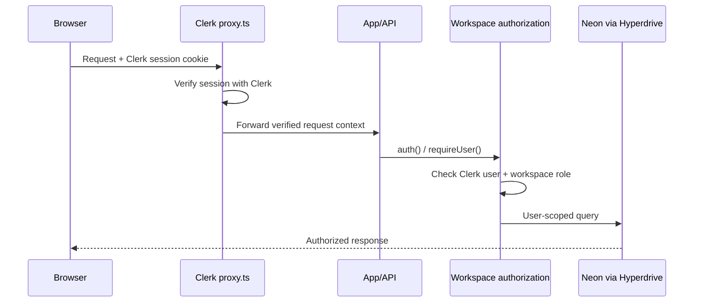

# Exelta authentication and credential handling

## Components

- `proxy.ts` runs Clerk's Next.js request middleware on application and API requests. The `/app` route is protected at the edge and redirects unauthenticated visitors to `/sign-in`.
- `app/layout.tsx` mounts `ClerkProvider` with the staging publishable key and the explicit sign-in/sign-up routes. Staging and production fail closed if the key is missing.
- `app/sign-in/[[...sign-in]]/page.tsx` and `app/sign-up/[[...sign-up]]/page.tsx` render Clerk's hosted sign-in and sign-up components.
- `lib/auth.ts` resolves the Clerk session with `auth()` and rejects requests without a user ID.
- `lib/workspace.ts` maps the Clerk user ID to the application user and checks workspace membership and role before data access.
- API handlers call `getAuthorizedWorkspace` or `requireUser`; the browser does not choose the authenticated user ID.

## Request flow

1. The browser sends its Clerk session cookie with the request.
2. `proxy.ts` runs `clerkMiddleware()` for dynamic application routes and API routes. It protects `/app` and makes verified auth state available to server-side helpers.
3. The app page or API handler calls `auth()` through `requireUser()`. An absent session returns 401; workspace membership or role failures return 403.
4. The authenticated Clerk user ID is resolved to the application user and authorized workspace. Database reads/writes are scoped by that user and membership.
5. Staging database traffic uses the isolated Cloudflare Hyperdrive binding and Neon staging database. Staging fails closed if Hyperdrive is missing; it never falls back to mock storage.



## Credential and token handling

- `NEXT_PUBLIC_CLERK_PUBLISHABLE_KEY` is public and is configured for the separate Exelta Staging Clerk instance. It is present in the staging Wrangler environment and staging build environment.
- `CLERK_SECRET_KEY` is a Cloudflare Worker secret, never a Wrangler variable, source file, or GitHub Actions log. The deploy workflow installs it from the protected GitHub `staging` environment.
- Clerk session cookies are handled and verified by Clerk middleware/server helpers. The app does not persist Clerk session tokens in its own database.
- GitHub OAuth uses a random state value and PKCE S256 verifier. The short-lived state, verifier, and Clerk user binding are stored in Secure, HttpOnly, SameSite=Lax cookies with a 10-minute lifetime.
- GitHub access and refresh tokens are encrypted before database storage using AES-256-GCM. `GITHUB_TOKEN_ENCRYPTION_KEY` must be a base64-encoded 32-byte secret. GitHub OAuth client credentials are server-side only.
- Stripe credentials, if billing is enabled in staging, are separate optional Worker secrets and are not part of Clerk authentication.

## Staging-only deployment values

The staging Worker is `exelta-staging` in Cloudflare account `6266f92b054b68ec69ff619d3869f195`, with isolated Hyperdrive `6b65f8e46ab34ec39b87abd9fdbf5636`. Its expected workers.dev origin is `https://exelta-staging.rieza902.workers.dev`.

Required protected GitHub Actions environment secrets:

- `CLOUDFLARE_API_TOKEN` — scoped to Workers Scripts edit and the account resources Wrangler needs.
- `CLERK_SECRET_KEY` — secret key from the Exelta Staging Clerk development instance.
- `STAGING_CLERK_TEST_COOKIE` — session cookie for test user one.
- `STAGING_CLERK_OTHER_TEST_COOKIE` — session cookie for a different test user.

The two test cookies are used only by the authenticated acceptance suite. They must represent different users. Never paste them into chat or commit them. The deploy workflow deliberately keeps `CI_REQUIRE_LIVE_ACCEPTANCE=1`; it fails if the two sessions are missing or invalid.

Optional Worker secrets for the GitHub repository integration are `GITHUB_CLIENT_SECRET` and `GITHUB_TOKEN_ENCRYPTION_KEY`; set `GITHUB_CLIENT_ID` and `GITHUB_REDIRECT_URI` as non-secret Worker variables. Billing requires `STRIPE_SECRET_KEY` and `STRIPE_WEBHOOK_SECRET`, with the plan price IDs as non-secret variables. These are optional for Clerk sign-in and the Memory Fabric acceptance flow.

## Local verification

```sh
npm run validate:staging
npm run typecheck
npm run test
npm run lint
APP_ENV=staging NEXT_PUBLIC_CLERK_PUBLISHABLE_KEY=<staging-publishable-key> npm run build
CI_REQUIRE_LIVE_ACCEPTANCE=1 STAGING_BASE_URL=https://exelta-staging.rieza902.workers.dev STAGING_CLERK_TEST_COOKIE=<user-one-cookie> STAGING_CLERK_OTHER_TEST_COOKIE=<user-two-cookie> npm run test:acceptance
```
